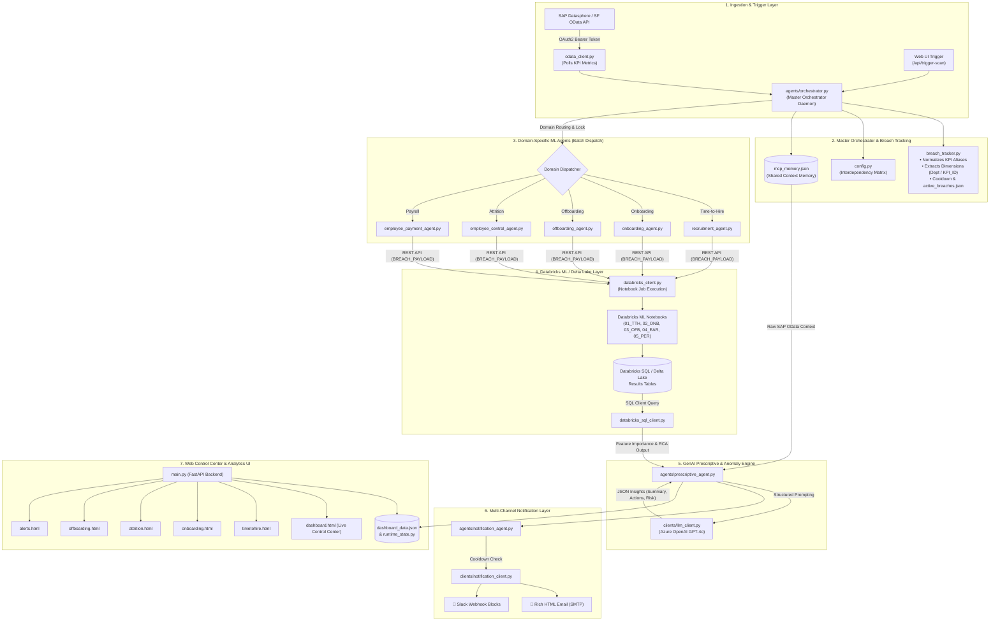
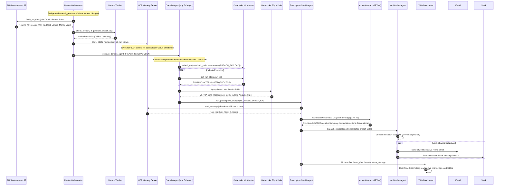

# 🏗️ SAP SF KPI Agentic AI — Comprehensive Technical Architecture & Flowchart

This document details the end-to-end system architecture, multi-agent orchestration, Databricks ML integration, MCP context memory, GenAI prescriptive reasoning, notification dispatch, and real-time dashboard visualization.

---

## 1. High-Level System Architecture Diagram



---

## 2. End-to-End Execution Sequence Diagram



---

## 3. Step-by-Step Technical Layer Breakdown

### Layer 1: Ingestion & Trigger System
- **OData OAuth2 Authentication**: [`clients/odata_client.py`](file:///d:/sf_kpi_agents/SAP-SF-KPI-AGENTS/clients/odata_client.py) generates client-credential access tokens from SAP Datasphere and fetches live employee lifecycle KPI data.
- **Autonomous & Manual Triggers**:
  - **Background Daemon**: Runs 24/7 on a customizable interval loop.
  - **FastAPI Endpoints**: `/api/trigger-scan` allows on-demand KPI evaluation directly from the UI.

### Layer 2: Master Orchestrator & Breach Tracking
- **Canonical Normalization**: Maps shorthand aliases (`tth`, `oct`, `ear`, `per`, `oft`) to canonical KPI names.
- **Dimension Resolution**:
  - **Individual Incidents** (`Time-to-Hire`, `Onboarding`, `Offboarding`): Tracked per `KPI_ID` or process identifier.
  - **Departmental KPIs** (`Employee Attrition Rate`): Tracked per `DEPARTMENT_ID` / `Department`.
- **Interdependency Matrix**: Resolves domino effects (e.g. Onboarding delays escalating into high early-stage Attrition).
- **Concurrency Locking**: Domain locks (`DOMAIN_LOCKS`) prevent overlapping Databricks runs for the same domain.

### Layer 3: Model Context Protocol (MCP) Memory
- **State Preservation**: [`agents/mcp_server.py`](file:///d:/sf_kpi_agents/SAP-SF-KPI-AGENTS/agents/mcp_server.py) acts as a high-speed memory server caching raw OData row context (`store_odata_row`).
- **Context Injection**: Injects raw employee attributes, department tags, and manager details into the downstream LLM prompts.

### Layer 4: Databricks ML Root Cause Analysis (RCA)
- **Batch Processing**: Groups all active breaches for a domain into a single `BREACH_PAYLOAD` JSON string:
  ```json
  [
    {
      "DEPARTMENT_ID": "D01",
      "YEAR": "2026",
      "MONTH": "7",
      "Severity": "CRITICAL"
    }
  ]
  ```
- **ML Notebooks**: Executes domain-specific ML notebooks in Databricks (`01_TTH_RCA`, `02_ONB_RCA`, `03_OFB_RCA`, `04_EAR_RCA`, `05_PER_RCA`) calculating anomaly scores, delay factors, and affected record lists.
- **Delta Lake Integration**: [`clients/databricks_sql_client.py`](file:///d:/sf_kpi_agents/SAP-SF-KPI-AGENTS/clients/databricks_sql_client.py) queries the generated Delta Lake tables.

### Layer 5: GenAI Prescriptive Analysis Engine
- **Data Partitioning**: Segregates findings into `ACTUAL_BREACH` (immediate remediation) and `PREDICTIVE_RISK` (early warning alerts).
- **LLM Reasoning**: [`agents/prescriptive_agent.py`](file:///d:/sf_kpi_agents/SAP-SF-KPI-AGENTS/agents/prescriptive_agent.py) calls Azure OpenAI GPT-4o to formulate:
  1. **Executive Summary**: Why it is late, by how much, and downstream impacts.
  2. **Prescriptive Actions**: Concrete action items, responsible role owners, and expected timeline.
  3. **Strategic Phasing**: Immediate containment, medium-term workflows, and long-term policies.
  4. **Risk Assessment & Precautions**: Operational, financial, and legal risk safeguards.

### Layer 6: Multi-Channel Notifications
- **Smart Cooldowns**: Enforces deduplication timers in `breach_tracker.py` so stakeholders are not spammed for persistent breaches.
- **HTML Email**: Dispatches responsive tables, KPI badges, root causes, and direct CTA buttons to relevant detail pages.
- **Slack Blocks**: Sends structured webhook messages with action buttons.

### Layer 7: Interactive Control Center UI
- **FastAPI Layer**: Exposes `/api/system-state`, `/api/results`, `/api/alerts`, `/api/trigger-scan`, and `/api/reset`.
- **Live Terminal & Swarm Status**: Visualizes active background agent states, memory footprint, and high-fidelity streaming logs.
- **KPI Deep-Dive Pages**: Specialized analysis views for [Time-to-Hire](file:///d:/sf_kpi_agents/SAP-SF-KPI-AGENTS/timetohire.html), [Onboarding](file:///d:/sf_kpi_agents/SAP-SF-KPI-AGENTS/onboarding.html), [Attrition](file:///d:/sf_kpi_agents/SAP-SF-KPI-AGENTS/attrition.html), [Offboarding](file:///d:/sf_kpi_agents/SAP-SF-KPI-AGENTS/offboarding.html), and [Alerts](file:///d:/sf_kpi_agents/SAP-SF-KPI-AGENTS/alerts.html).
- **Global Theme Engine**: Dark / Light theme toggle with `localStorage` persistence and anti-flicker pre-render scripts.
